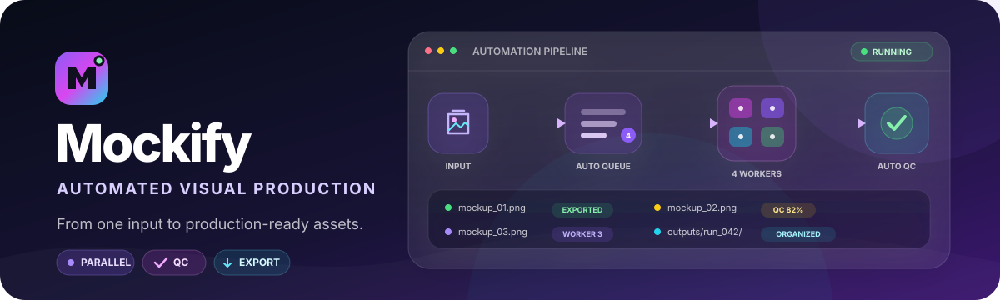
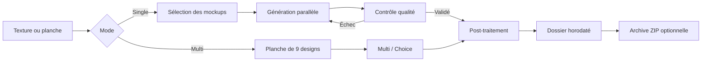

<div align="center">
  

  <br>

  
  
  
  

  <p><strong>Transformez une texture en une collection cohérente de mockups Kindle.</strong></p>
  <p>Génération parallèle, contrôle qualité, planches multi-design et exports organisés.</p>
</div>

---

## Présentation

Mockify est un studio en ligne de commande conçu pour produire des visuels de coques Kindle à partir d’une texture. Il orchestre la génération d’images, le contrôle qualité, les nouvelles tentatives et l’organisation des exports dans un workflow unique.

Le projet propose deux parcours :

| Mode | Usage | Résultats |
| --- | --- | --- |
| **Single** | Appliquer une texture aux mockups sélectionnés | `basic`, `double`, `open`, `clear` |
| **Multi** | Créer ou utiliser une planche de 9 designs | planche, `multi`, `choice` |

## Points forts

- **Parallélisme automatique** — un worker par mockup sélectionné, avec une limite de 8.
- **Contrôle qualité intégré** — analyse visuelle et nouvelle tentative automatique en mode parallèle.
- **Exports propres** — un dossier horodaté par exécution et des noms de fichiers normalisés.
- **Workflow multi-design** — génération d’une planche 3 × 3 puis application sur deux présentations commerciales.
- **Suivi des coûts** — utilisation réelle lorsqu’elle est disponible, sinon estimation clairement indiquée.
- **Archivage sécurisé** — création d’un ZIP, vérification CRC, puis suppression des seuls dossiers archivés.
- **Tests hors ligne** — la suite de tests ne contacte aucune API et ne consomme aucun crédit.

## Workflow



## Installation

### Prérequis

- Python 3.10 ou plus récent ;
- une clé API OpenAI ayant accès aux modèles configurés ;
- PowerShell pour les exemples Windows ci-dessous.

### Mise en place

```powershell
git clone git@github.com:Zibgame/Mockify.git
cd Mockify
python -m venv .venv
.\.venv\Scripts\Activate.ps1
python -m pip install --upgrade pip
python -m pip install -r requirements.txt
python -m pip install -e .\src
```

Créez ensuite un fichier `.env` à la racine :

```dotenv
OPENAI_API_KEY=sk-...
```

> [!IMPORTANT]
> Le fichier `.env` est ignoré par Git. Ne publiez jamais votre clé API.

## Démarrage rapide

### Générer des mockups depuis une texture

Placez votre image dans `assets/textures/`, puis exécutez :

```powershell
python src/main.py "assets/textures/mon-design.png"
```

Mockify demande les mockups à produire et alloue automatiquement les threads nécessaires. Pour limiter explicitement la concurrence :

```powershell
python src/main.py "assets/textures/mon-design.png" --threads 4
```

### Créer une présentation multi-design

```powershell
python src/main.py
```

Choisissez **Multi**, puis utilisez une planche existante ou générez une nouvelle planche de 9 designs. Mockify peut ensuite produire `multi`, `choice`, ou les deux.

### Archiver les résultats

```powershell
python src/main.py --archive-outputs
```

La même action est disponible avec **Compress** dans le menu principal. Les dossiers sont ajoutés à `outputs/mockify_outputs.zip`. L’archive est contrôlée avant toute suppression ; les fichiers placés directement à la racine de `outputs/` restent intacts.

## Organisation des sorties

Chaque exécution crée son propre dossier :

```text
outputs/
└── mon-design_20261029_153000/
    ├── mon-design_basic.png
    ├── mon-design_double.png
    ├── mon-design_open.png
    └── mon-design_clear.png
```

Les caractères incompatibles avec les noms de fichiers sont remplacés automatiquement. En cas de lancement pendant la même seconde, un suffixe numérique évite tout écrasement.

## Référence CLI

```text
python src/main.py [texture] [--threads N] [--archive-outputs]
```

| Option | Description |
| --- | --- |
| `texture` | Chemin de la texture utilisée en mode Single. |
| `--threads N` | Limite manuelle comprise entre 1 et 8 ; automatique si omise. |
| `--archive-outputs` | Archive les dossiers de sortie, vérifie le ZIP puis retire les dossiers archivés. |
| `-h`, `--help` | Affiche l’aide complète. |

## Configuration

Toutes les options suivantes peuvent être placées dans `.env` :

| Variable | Défaut | Rôle |
| --- | --- | --- |
| `OPENAI_IMAGE_MODEL` | `gpt-image-2.5-sunburst` | Modèle de génération ou de modification d’image. |
| `OPENAI_IMAGE_SIZE` | `1024x1024` | Dimensions demandées à l’API. |
| `OPENAI_IMAGE_QUALITY` | `medium` | Niveau de qualité des images. |
| `OPENAI_CHECKER_MODEL` | `gpt-5.6-luna` | Modèle chargé du contrôle visuel. |
| `OPENAI_CHECKER_DETAIL` | `original` | Niveau de détail transmis au contrôleur. |
| `OPENAI_CHECKER_REASONING` | `low` | Niveau de raisonnement du contrôleur. |
| `MOCKIFY_ANTIPROVENANCE` | `balanced` | Profil de post-traitement : `off`, `light`, `balanced`, `aggressive`, `max`. |
| `MOCKIFY_VERIFY_PROVENANCE` | `0` | Active la vérification avec `1`, `true` ou `yes`. |
| `MOCKIFY_REGENERATE` | `off` | Backend optionnel : `off`, `local` ou `http`. |
| `MOCKIFY_REGENERATE_STRENGTH` | `0.75` | Intensité de régénération entre `0.0` et `1.0`. |

Exemple :

```dotenv
OPENAI_API_KEY=sk-...
OPENAI_IMAGE_QUALITY=high
OPENAI_CHECKER_DETAIL=high
MOCKIFY_ANTIPROVENANCE=off
```

> [!NOTE]
> Le post-traitement peut modifier légèrement les pixels et ne garantit pas la suppression de tous les signaux de provenance. Utilisez ces fonctions conformément aux règles des plateformes concernées.

## Tests et validation

La suite est entièrement locale et n’effectue aucun appel API :

```powershell
python -m unittest discover -s tests -v
python -m compileall -q src tests
```

Les tests couvrent les fichiers, prompts, coûts, conversions Base64, masques, noms sûrs, threads automatiques, dossiers horodatés, archives ZIP et opérations PNG.

## Architecture

```text
Mockify/
├── assets/
│   ├── mockups/         # modèles nécessaires à la génération
│   ├── prompts/         # instructions des différents workflows
│   └── textures/        # entrées personnelles, ignorées par Git
├── docs/                # identité visuelle et documentation
├── outputs/             # exports locaux, ignorés par Git
├── src/
│   ├── main.py          # CLI et orchestration principale
│   └── antiprovenance/  # post-traitement d’image optionnel
├── tests/               # suite de tests hors ligne
├── .env                 # secrets locaux, ignorés par Git
└── requirements.txt
```

## Dépannage

| Problème | Solution |
| --- | --- |
| `OPENAI_API_KEY is not set` | Ajoutez la clé dans `.env` à la racine. |
| Texture introuvable | Vérifiez le chemin et utilisez des guillemets s’il contient des espaces. |
| Modèle indisponible | Configurez dans `.env` un modèle accessible à votre compte. |
| Erreur de masque | Le mockup et son masque source doivent avoir les mêmes dimensions. |
| Import `antiprovenance` impossible | Relancez `python -m pip install -e .\src`. |

## Données et coûts

Les images fournies au programme peuvent être transmises à l’API configurée. Assurez-vous de disposer des droits nécessaires. Chaque génération peut entraîner un coût ; Mockify affiche les métriques retournées par l’API ou une estimation clairement signalée.
